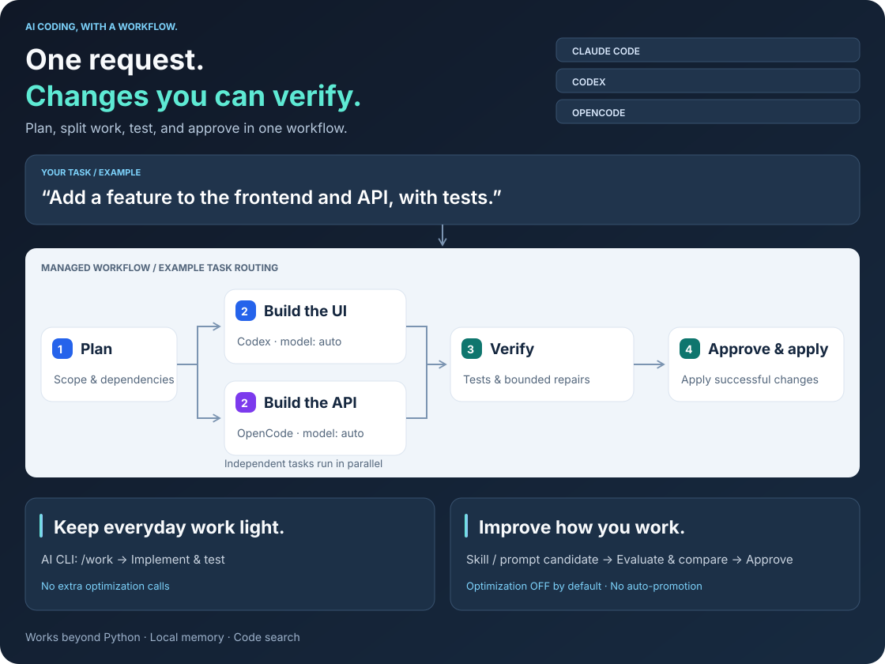

<div align="center">

# ego

**One request. Changes you can verify.**

Bring planning, task routing, tests, and memory to Claude Code, Codex, OpenCode, and Antigravity.


**English** · [日本語](docs/ja/README.md)

</div>

## Overview

`ego` is a CLI-first harness for AI coding CLIs (Claude Code, Codex, OpenCode, Antigravity / `agy`). It generates a shared `/work` skill, agents and instructions for each CLI, and provides commands for verified multi-host task runs, memory, and session handoff. It has no runtime dependencies beyond Python.

<picture>
  <source media="(max-width: 600px)" srcset="docs/en/assets/workflow-en-mobile.svg">
  
</picture>

| | Goal | What ego does |
|---|---|---|
| ⚡ | Fix code in your usual AI CLI | `/work` inspects, implements and tests. Small fixes get no planning documents |
| 🧩 | Split work across AI CLIs | Host and model per task node; dependencies respected, independent nodes run in parallel |
| ✅ | Verify before applying | Changes are made and tested in a staging copy or Git worktree, then applied only with approval |
| 🔁 | Work until a command passes | Goal loop: plan → execute → evaluate → replan, bounded by iterations, budget and time |
| 💾 | Continue later, or in another CLI | Memory, checkpoints, and handoff between Claude Code / Codex / OpenCode / AGY |
| ♻️ | Keep long sessions small | `ego run <cli>` checkpoints, clears and resumes the session at a context threshold |

---

## Quick start

### 1 · Install

Requires Python **3.11+** on macOS / Linux.

```bash
uv tool install git+https://github.com/jumtra/ego    # or: pipx install git+https://github.com/jumtra/ego
ego --version
```

Release wheels, development installs and updating: [Setup](docs/en/setup.md).

### 2 · Apply to a project

```bash
cd /path/to/project
ego apply          # interactive wizard; review the change list and confirm with y
```

Scripted setup:

```bash
ego apply --hosts claude,codex --profile balanced --policy strict
```

This writes `.ego/config.toml` plus the skills, agents and instruction blocks for the selected CLIs. Every option and generated file: [Setup](docs/en/setup.md). Every setting: [Configuration](docs/en/configuration.md).

### 3 · Work

Start your AI CLI in the project and ask:

```text
/work Add timeout input validation and run the related tests
```

`/work` is the everyday entry point. The AI picks the smallest workflow that fits and runs `ego` commands itself when a task needs managed execution. To let ego rotate the session automatically at a context limit, start the CLI through ego:

```bash
ego run claude     # also: codex, opencode, agy
```

### 4 · Maintain

| Command | Purpose |
|---|---|
| `ego doctor` | Check host CLIs, providers and configuration |
| `ego status` | Show drift between `.ego/config.toml` and the generated files |
| `ego sync --apply` | Re-generate files after editing `.ego/config.toml` |
| `ego update --yes --sync-all` | Update ego, then re-render every registered project |
| `ego rollback` | Undo the last apply |
| `ego uninstall` | Remove ego from the project (`--cli` removes the CLI symlinks) |

---

## Documentation

| Topic | English | 日本語 |
|---|---|---|
| Install, apply, update, uninstall | [Setup](docs/en/setup.md) | [セットアップ](docs/ja/setup.md) |
| `.ego/config.toml`, environment variables | [Configuration](docs/en/configuration.md) | [設定](docs/ja/configuration.md) |
| `/work`, managed runs, Task JSON, goal loop | [Workflows](docs/en/workflows.md) | [ワークフロー](docs/ja/workflows.md) |
| Checkpoints, CLI handoff, `ego run` | [Sessions](docs/en/sessions.md) | [セッション](docs/ja/sessions.md) |
| Every command and flag | [Command reference](docs/en/commands.md) | [コマンドリファレンス](docs/ja/commands.md) |
| Trust boundaries and limits | [Security](docs/en/security.md) | [セキュリティ](docs/ja/security.md) |

License: [MIT](LICENSE)
