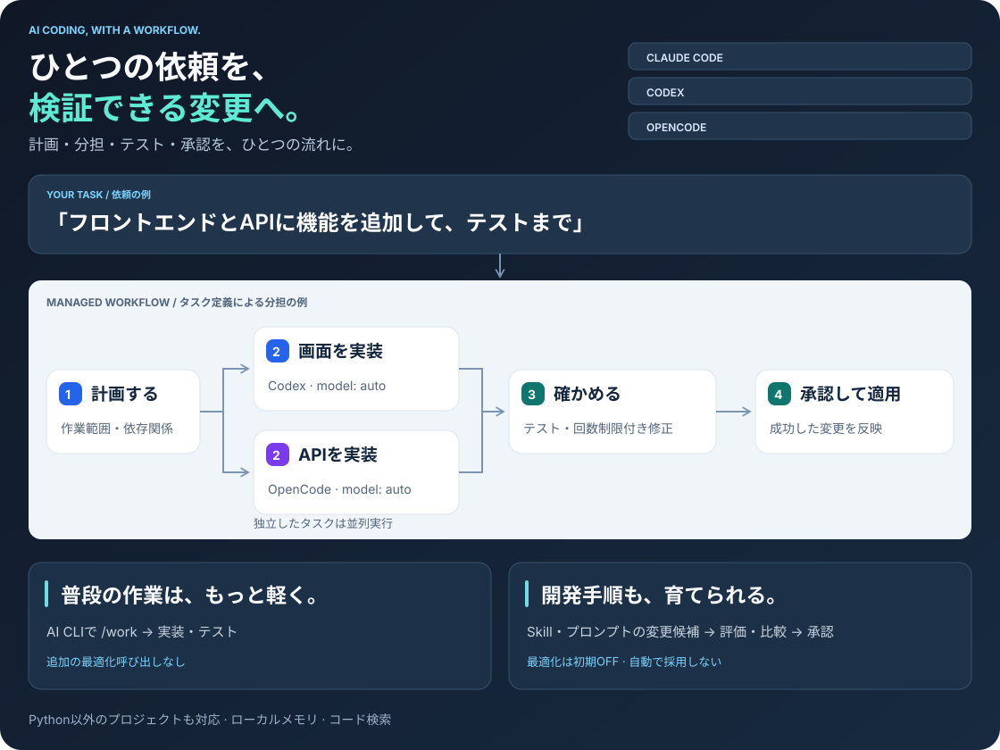

<div align="center">

# ego

**ひとつの依頼を、検証できる変更へ。**

Claude Code・Codex・OpenCode・Antigravityに、計画・分担・テスト・記憶を。


[English](../../README.md) · **日本語**

</div>

## 概要

`ego` は、複数のAIコーディングエージェント（Claude Code、Codex、OpenCode、Antigravity）に対して、安全な計画立案、タスク分担、テスト駆動検証、知見の記憶・引き継ぎを提供するCLIハーネスです。

<picture>
  <source media="(max-width: 600px)" srcset="assets/workflow-ja-mobile.svg">
  
</picture>

| | やりたいこと | できること |
|---|---|---|
| ⚡ | いつものAI CLIですぐ直す | `/work`で必要なファイルを読み、実装・テスト。小さな修正に大きな計画書は不要 |
| 🧩 | 複数のAIに分担する | タスクごとにHost・Modelを指定。依存関係に沿って実行し、独立した作業は並列化 |
| ✅ | 結果を確かめて反映する | 作業用コピーでテスト・回数制限付き修正。検証済みの変更を承認して適用 |
| 💾 | 次の作業へ引き継ぐ | 知見を保存・検索。チェックポイントに目的・結果・次の作業を残して再開 |
| 🔬 | 開発手順そのものを改善する | Skill・プロンプトの候補を評価・比較してから採用。最適化は初期OFF |
| 🎛️ | プロジェクトに合わせる | 対話式セットアップでHost・規定モデル・Profile・Policy・Memory・コード解析・実行方式を選択 |

---

## 使用方法

### 1 · インストール

Python **3.11以上**、macOS / Linuxで実行します。

```bash
# 推奨: クローン不要のグローバルCLI(どちらか一方)
uv tool install git+https://github.com/jumtra/ego
pipx install git+https://github.com/jumtra/ego

# 公開済みリリース wheel から pip 形式で導入(git 不要。バージョンは最新リリースに置き換え)
pipx install https://github.com/jumtra/ego/releases/download/v0.0.9/ego-0.0.9-py3-none-any.whl
uv tool install https://github.com/jumtra/ego/releases/download/v0.0.9/ego-0.0.9-py3-none-any.whl
pip install https://github.com/jumtra/ego/releases/download/v0.0.9/ego-0.0.9-py3-none-any.whl  # 仮想環境内で

ego --version
ego update --yes   # 以後の更新: 検証済みの最新リリース wheel を導入
```

ego 自体を開発する場合は、リポジトリをクローンして `make install`(シンボリックリンク)か `pip install -e .` を使います。この場合 `ego update --yes` はそのチェックアウトを fast-forward するので、CLI はそこで checkout 中のブランチに追従します。

`~/.local/bin` を PATH に追加すると、どのプロジェクトからでも `ego` コマンドを利用できます。

---

### 2 · プロジェクトへの適用（`ego apply`）

対象プロジェクトのディレクトリで実行します：

```bash
cd /path/to/project
ego apply
```

通常の対話ターミナルでは、選択ウィザードが表示されます。設定を選んで差分を確認し、`y` で適用します。

#### コマンド引数・フラグ一覧

対話を使わず、引数で直接指定して適用することも可能です：

| 引数・オプション | 説明 | 指定例 |
|---|---|---|
| `--hosts <list>` | 生成対象のAIホストをカンマ区切りで指定 | `--hosts claude,antigravity` |
| `--policy <mode>` | セキュリティ方針（`strict`: 安全重視 / `relaxed`: 自律開発モード） | `--policy relaxed` |
| `--profile <name>` | 生成プロファイル（`minimal`, `balanced`, `full`） | `--profile balanced` |
| `--models <json>` | ホストごとの規定モデルを指定（JSON形式） | `--models '{"claude":"sonnet"}'` |
| `--graph <provider>` | コード解析プロバイダ（`none`, `codegraph`, `graphify`） | `--graph none` |
| `--memory <provider>` | 記憶プロバイダ（`file`, `engram`） | `--memory file` |
| `--runtime <mode>` | 実行環境（`native`: 直接実行 / `managed`: 作業コピー検証） | `--runtime native` |
| `--dry-run` | ファイルを変更せず、変更予定の差分のみを表示 | `--dry-run` |
| `--check` | 差分の有無を検証（CI用：差分があれば非ゼロ終了） | `--check` |
| `--root <path>` | 適用対象のプロジェクトパス（既定値: カレントディレクトリ） | `--root /path/to/project` |

例：
```bash
# CIや自動化スクリプトでの非対話適用
ego apply --hosts claude,antigravity --policy relaxed --profile balanced
```

---

### 3 · 設定ファイル（`.ego/config.toml`）の変更方法

`ego apply` を実行すると、プロジェクトルートに **`.ego/config.toml`** が作成されます。

#### 変更手順

1. **直接編集**: `.ego/config.toml` をお好みのエディタで直接編集します。
2. **同期（反映）**: 編集後、必ず以下のコマンドを実行して各AIツール向けの設定ファイルを再生成します。
   ```bash
   ego sync
   ```

#### 主な設定項目と意味

```toml
schema_version = 1
profile = "balanced"            # "minimal" (最小) / "balanced" (推奨) / "full" (全機能)
clear_suggest_tokens = 0       # Claude Code / `ego run`: このコンテキストトークン数でチェックポイント保存とクリア（0 で無効）
run_yolo = false               # `ego run`: CLIを権限確認スキップ付きで起動（起動ごとに `--yolo` / `--no-yolo` で上書き）

[hosts]
enabled = [                     # 連携するAIエージェント
    "claude",                   # Claude Code (.claude/, CLAUDE.md)
    "antigravity",              # Antigravity (.agents/, AGENTS.md)
    "codex",                    # OpenAI Codex (.codex/)
    "opencode",                 # OpenCode (.opencode/)
]

[hosts.models]                  # 各ホストで使う既定モデル（オプション）
claude = "sonnet"
codex = "auto"

[runtime]
mode = "native"                 # "native" (通常実行) / "managed" (作業用コピーで検証)
policy_mode = "strict"          # "strict" (保護フック有効) / "relaxed" (AIに自律push等を許可)

[runtime.security]
command_allowlist = ["git", "python", "pytest"] # 許可するコマンド名

[memory]
provider = "file"               # "file" (.agent-memory) / "engram" (外部MCP)

[code_intelligence]
provider = "none"               # "none" / "codegraph" / "graphify"
```

> [!TIP]
> 個人開発やプロトタイプで、AIに `git push` や設定変更まで自律して任せたい場合は、`runtime.policy_mode = "relaxed"` に設定すると便利です。

---

### 4 · 日常の作業（`/work` に依頼する）

プロジェクトでAI CLI（Claude Code や Antigravity 等）を起動し、チャットでやりたいことを伝えます。

```text
/work タイムアウト値の入力チェックを追加して、関連テストを実行して
```

**普段の入口は `/work` です。** AIが自動的に必要な `ego` サブコマンドを内部で呼び出します：
- 調査 → 計画・タスク分割 → 実装 → テスト検証 → 結果報告
- 編集前に「なぜ必要か」と「何をもって完了か」を確認します。結論が変わる未確定点があり、誤推測のやり直しが高くつく場合に限り、質問は1問ずつ行います。それ以外は前提を置いて進め、報告に前提を明記します
- 大規模・複数ホストの実行では、各ステージの `intent`・`done_when`・`non_goals`・`assumptions`・`provides` をワーカーへのプロンプトに渡します。ステージが存在する理由と、後続ステージが何に依存するかを把握できます

---

### 5 · 便利な運用コマンド

| コマンド | 説明 |
|---|---|
| `ego doctor` | インストール済みのAI CLIや設定の健全性を診断 |
| `ego run <claude\|codex\|opencode\|agy>` | CLIを ego 管理の端末で起動し、`clear_suggest_tokens` に達したら自動でチェックポイント保存・クリア・再開。`--yolo` で権限確認をスキップ |
| `ego status` | 設定のドリフト（手動編集や競合）を確認 |
| `ego projects list` | 適用済みプロジェクトごとの適用バージョンとドリフトを一覧（既存分は `ego projects scan <dir>` で登録） |
| `ego update --yes --sync-all` | ego 本体を更新（git checkout は fast-forward、それ以外はリリース wheel）し、登録済み全プロジェクトを各自の設定のまま再生成 |
| `ego rollback` | 直前の `ego apply` での変更を元に戻す（バックアップから復元） |
| `ego uninstall` | プロジェクトから ego の管理ファイル・ブロックを安全に削除 |
| `ego uninstall --cli` | `~/.local/bin` から ego のグローバルCLIをアンインストール |

詳細なオプションは [コマンド一覧](../en/commands.md) や [セットアップの詳細](apply_choices.md) を参照してください。
